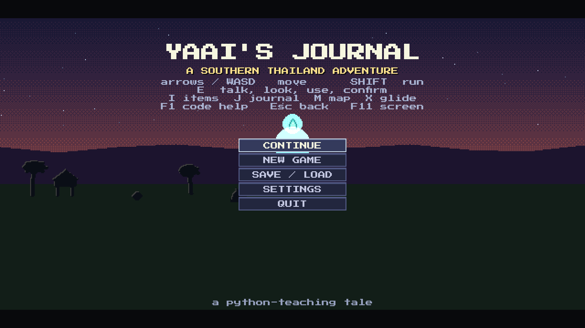
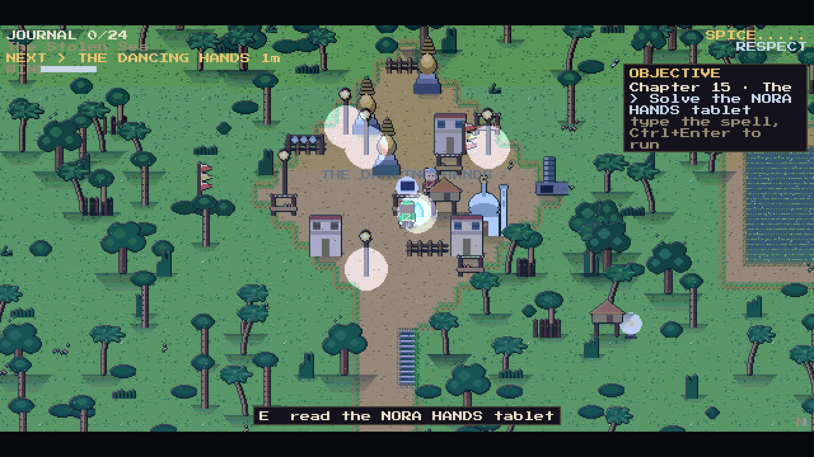
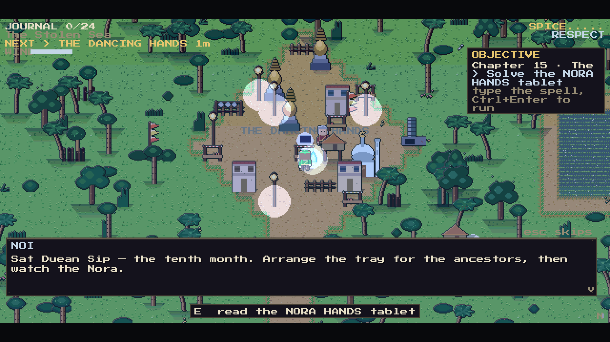
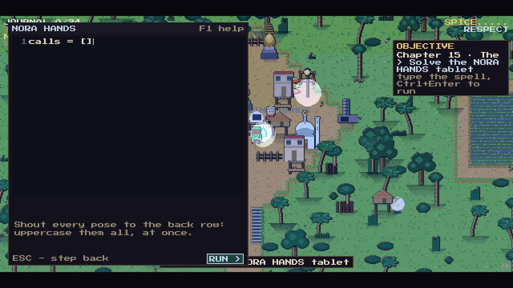
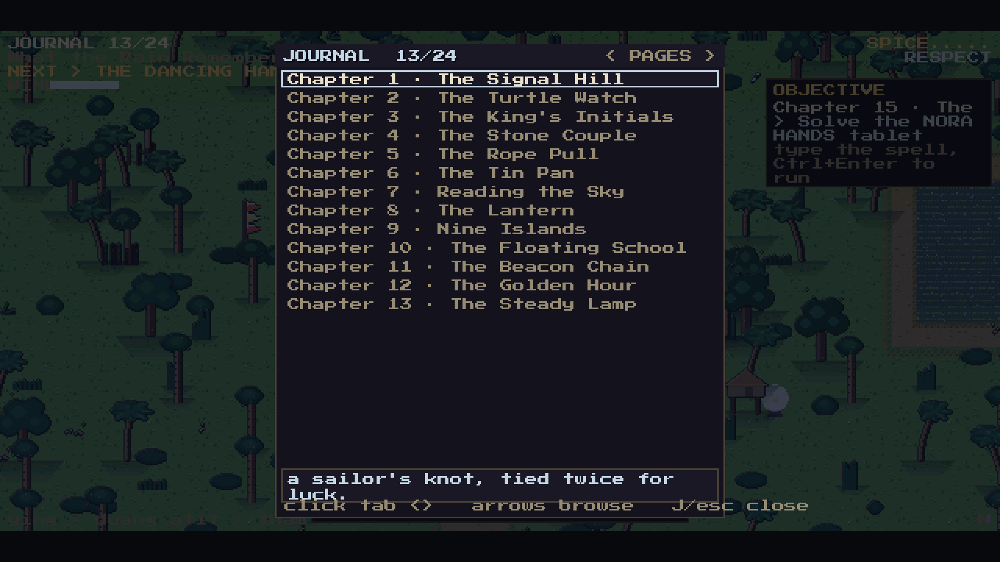
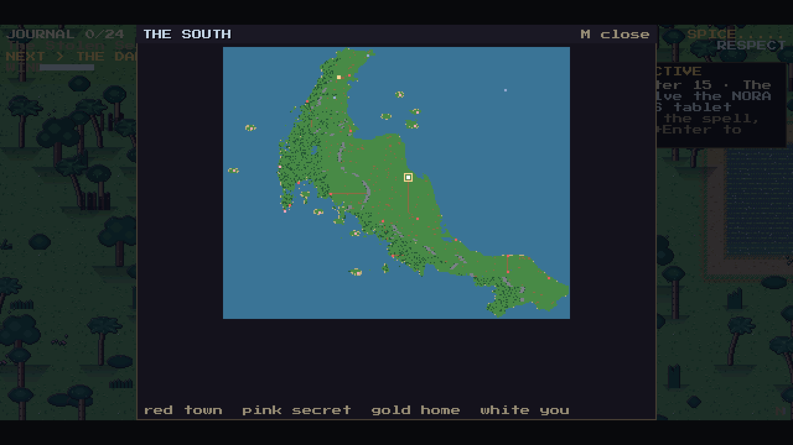

# Yaai's Journal — A Southern Thailand Adventure

A 2-D pixel-art adventure game that teaches **Python** and the culture, history
and geography of **Southern Thailand** at the same time.

You are a young apprentice who travels the southern coast with the puppet
teacher Noi, restoring the 24 pages of Yaai's journal, torn away by a storm.
Every page is won the only honest way: by writing a small, real Python program
that the game itself checks.

```
docs/screenshots/fig4_2_overworld.png
```

## What is in the game

| | |
|---|---|
| **24 story stops in 5 acts** | Chumphon → Narathiwat: the Gulf, the Andaman coast, the rain country, the deep South |
| **24 Python puzzles** | 8 archetypes: strings, lists, loops, dictionaries, files, functions, classes, and a final gauntlet that combines everything |
| **24 Thai words** | one southern word per stop, with a Thai character to say it |
| **40 heritage landmarks** | the Chaiya chedi, the Phra Mahathat stupa, Phuket's old shophouses, Pattani's mosque … |
| **25 side quests, 74 road encounters, 18 lore documents** | the coast is alive between the stops |
| **2 film-style cutscenes** | the storm that took the pages, and the road home |
| **A rune tablet at every stop** | the pre-filled code always fails its own validator — no lesson can be clicked past |

Every picture in the game is **generated in code** (`game/artgen.py`,
`game/tiles.py`): the build ships no image files, and the whole world is
data-driven, so a new province is one dictionary.

## Screenshots

| | |
|---|---|
|  |  |
|  |  |
|  |  |

## Download

**Latest release: [v0.4.0 — the Southern Thailand release](https://github.com/krittidet007/Yaais_Journal/releases/tag/v0.4.0)**

| asset | what it is |
|---|---|
| `YaiisJournal-Linux.tar.gz` | the Linux build (x86-64): unpack it and run `./install.sh`, no Python needed |
| `Yaais_Journal-v0.4.0-source.tar.gz` | the full source (Linux/macOS) — unpack and `pip install -r requirements.txt && python main.py` |
| `Yaais_Journal-v0.4.0-source.zip` | the same source, for Windows |
| `Yaais_Journal_Report.pdf` | the project report, 29 pages, English |
| `Yaais_Journal_Report_TH.pdf` | the report in Thai, 25 pages |
| `Computer Project Board 2026.pdf` | the three-panel competition board, 8 pages, 60 + 120 + 60 cm |

Windows and macOS binaries are built from this source (`build_windows.bat`,
`installer/mac`) — PyInstaller cannot cross-compile, so each platform builds
its own binary.

## Run it from source

```bash
pip install -r requirements.txt
python main.py
```

* **Windows** — double-click `run.bat`; it installs pygame-ce and starts the
  game, falling back to the `py` launcher when `python` is not on PATH.
* **Linux / macOS** — `./run.sh`.
* **Standalone Windows `.exe`** — run `build_windows.bat` *on a Windows
  machine*; it turns `YaiisJournal.spec` into `dist/YaiisJournal.exe` with
  PyInstaller. PyInstaller cannot cross-compile, so each platform builds its
  own binary.

## Tests

```bash
python -m unittest discover -s tests -v
```

201 automated cases run headless in about 30 seconds: the story data, the
puzzle validator, the save system, the world generator and the pixel-art
pipeline. A separate check confirms that all 24 prepared solutions are
accepted and all 24 pre-filled starters are rejected.

## Controls

| Key | Action | Key | Action |
|---|---|---|---|
| Arrows / WASD | move | `E` | talk, look, use, confirm |
| `Shift` | run | `I` | items |
| `X` | glide | `J` | journal |
| `M` | map | `O` | settings |
| `F5` | save | `F11` | full screen |
| `F1` | code help | `Esc` | back |

Mouse works too: click the buttons, drag the code, scroll the journal.

## Layout

```
main.py            the game loop, the window, the input map
game/              52 modules: story engine, puzzle validator, world,
                   art generator, UI, save system, content data
tests/             201 automated cases
tools/             report and board artwork, validator check
installer/         the packaging scripts for Windows, Linux and macOS
docs/screenshots/  the pictures used in the report and the board
```

## Credits

Made by Master Krittidet Koetsiri, Master Pasit Anusonthi-adisai and Master
Chiewin Klingbuathong, with advisers Mrs. Paratee Stangmongkol and
Mrs. Niparat Neamsong — Benjamarachutit School, Nakhon Si Thammarat, under
the office of the Secondary Education Area Commission.


**Source code:** <https://github.com/krittidet007/Yaais_Journal> — scan the code
above to open this repository.

The game is free to use and study for education. Cultural content is kept
factual and respectful, and the Thai words are the southern ones spoken in
the provinces the journey passes through.
